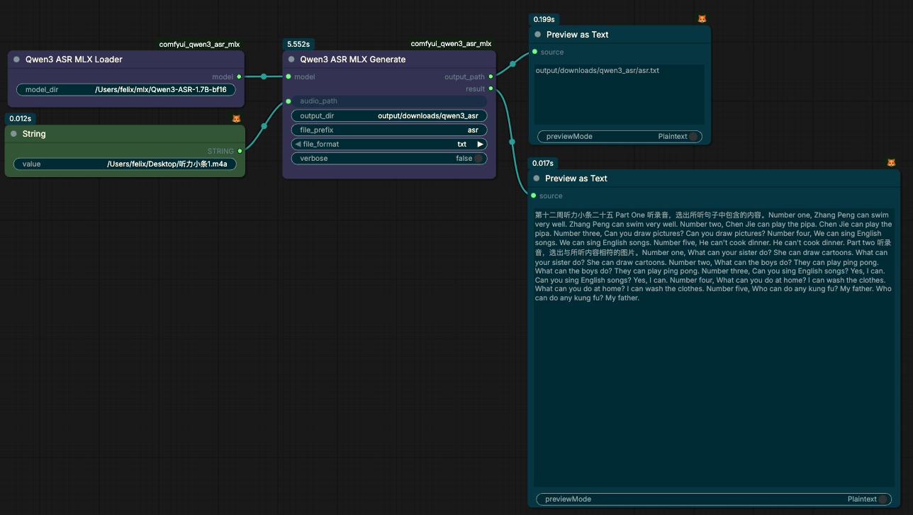

# ComfyUI‑Qwen3ASR‑MLX
ComfyUI custom nodes for Qwen3 Speech‑To‑Text(ASR) using Apple MLX backend.
This project targets **Apple Silicon chips only**, provides workflow for audio(wav/mp3) → subtitle(lrc/srt/vtt/json/txt) generation.

> Backend Model: [Qwen3‑ASR](https://huggingface.co/collections/mlx‑community/qwen3‑asr)

> ⚠️ Important Note
> 1. `Qwen3‑ForcedAligner‑0.6B‑8bit` related alignment code is reserved in source, **`mlx‑audio` official PyPI release does NOT contain `alignment` sub‑module**, only github main dev branch has it.
> 2. If import error occurs, node will fallback to `split_by_text_ratio_interpolate` character‑ratio interpolation logic, workflow will not crash.
> 3. Forced‑aligner is not enabled by default in current workflow, you may delete local aligner model weights to save disk space.



## Features
- ✅ Qwen3‑ASR MLX backend, full hardware acceleration on Apple Silicon(M1‑M4 Pro/Max)
- ✅ Two ASR execution modes: **single file mode / batch multi‑shard folder mode**
- ✅ Auto subtitle splitting: character‑punctuation ratio interpolation (no word‑level timestamp, for TTS‑generated audio)
- ✅ Output format support: `txt / srt / vtt / json / lrc` (LRC with metadata tags: ti/ar/al/by)
- ✅ Time offset auto‑accumulate for batch‑split audio slices
- ✅ Clean temporary json artifacts after batch processing
- ✅ Language hint for multi‑language audio to reduce recognition drift

> Limitation:
> - The built‑in subtitle split `split_by_text_ratio_interpolate` is a fallback solution **without real word‑level timestamps**. It works well for steady‑speed TTS speech; timestamps may drift for singing audio.
> - Real word‑level forced‑align depends on unreleased `mlx‑audio` alignment module.

## Install
### 1. Install dependencies
```bash
pip install mlx‑audio soundfile
```
> Note: `mlx‑audio` from PyPI does **NOT** include ForcedAligner alignment module, do NOT expect forced‑align function working out‑of‑box.

### 2. Clone this repo to ComfyUI custom_nodes
```bash
cd ComfyUI/custom_nodes
git clone https://github.com/feishengfei/comfyui_qwen3_asr_mlx.git
cd comfyui_qwen3_asr_mlx
```

### 3. Download MLX Qwen3‑ASR model
You can use `hfd.sh`(recommended with hf‑mirror) or `huggingface‑cli`.
```bash
# example: download Qwen3‑ASR‑0.6B‑8bit
HF_ENDPOINT=https://hf‑mirror.com \
bash hfd.sh mlx‑community/Qwen3‑ASR‑0.6B‑8bit \
--tool aria2c -x 8 \
--local-dir ./models/mlx‑Qwen3‑ASR‑0.6B‑8bit
```

> In node `Qwen3ASRMLXLoader`, fill your local absolute model path or use huggingface repo‑id for auto‑cache.

## Nodes Document
### Qwen3 ASR MLX Loader
> Load Qwen3‑ASR MLX model, with global singleton cache to avoid repeated weight loading.
Category: `Qwen3‑ASR‑MLX`

**Inputs(required)**
| Name | Type | Description |
|---|---|---|
| model_dir | STRING | Local absolute model folder path OR huggingface repo‑id, e.g. `mlx‑community/Qwen3‑ASR‑0.6B‑8bit` |

**Outputs**
| Name | Type | Description |
|---|---|---|
| model | QWEN3_ASR_MODEL | Cached ASR model handle, feed to ASR generate nodes |

---

### Qwen3 ASR MLX Generate(单文件)
> Process single wav/mp3 file on disk, output subtitle file & text content.
Category: `Qwen3‑ASR‑MLX`, OUTPUT_NODE

**Inputs**
| Group | Name | Type | Description |
|---|---|---|---|
| required | model | QWEN3_ASR_MODEL | Model handle from `Qwen3ASRMLXLoader` |
| required | audio_path | STRING | Absolute disk path of wav/mp3 audio file |
| required | output_dir | STRING | Directory for output subtitle files |
| required | file_prefix | STRING | Output filename prefix (without extension) |
| required | file_format | dropdown | `txt` / `srt` / `vtt` / `json` |
| required | verbose | BOOLEAN | Print runtime log |
| optional | language_hint | dropdown | `auto`/`zh`/`en`/`ja`/`ko`/`ru`/`fr`; hint for reduce recognition drift |

**Outputs**
| Name | Type | Description |
|---|---|---|
| output_path | STRING | Absolute path of generated subtitle file |
| result | STRING | Full subtitle text content string for downstream node wiring |

> Note: This single‑file node **does NOT include auto‑subtitle‑split logic**. Auto‑split is only implemented in batch‑folder node.

---

### Qwen3 ASR MLX Batch 文件夹分片合并ASR
> Process a folder contains numbered audio slices like `tts_000.wav`, `tts_001.mp3`.
> Automatically sort files by numeric suffix, accumulate time‑offset between slices, merge into one complete subtitle file.
> Supports auto subtitle split by punctuation + character‑ratio interpolation.
Category: `Qwen3‑ASR‑MLX`, OUTPUT_NODE

**Inputs**
| Group | Name | Type | Description |
|---|---|---|---|
| required | model | QWEN3_ASR_MODEL | Model handle from `Qwen3ASRMLXLoader` |
| required | audio_folder | STRING | Absolute path of folder holding slice audios |
| required | file_prefix | STRING | File prefix to match slice files, e.g. `tts` matches `tts_000.wav` |
| required | output_dir | STRING | Output directory for merged subtitle & temp artifacts |
| required | out_filename | STRING | Output merged file base name (no extension) |
| required | file_format | dropdown | `txt`/`srt`/`vtt`/`json`/`lrc` |
| required | verbose | BOOLEAN | Print runtime log |
| required | trigger | * | Dummy trigger input, ensure upstream audio file writing finish before run ASR |
| optional | auto_split_subtitle | BOOLEAN, default=True | Enable: split long ASR segments by punctuation+char‑ratio interpolation(no word‑level time). Disable: output raw large ASR segments for debug original timestamps. ⚠️ Not suitable for singing audio. |
| optional | language_hint | dropdown | `auto`/`zh`/`en`/`ja`/`ko`/`ru`/`fr`; language hint to reduce recognition drift. Recommend `zh` for Chinese TTS audio. |
| optional | title_for_lrc | STRING | LRC meta tag `[ti]`, only works when file_format=lrc; leave empty to skip |
| optional | artist_for_lrc | STRING | LRC meta tag `[ar]`, only works when file_format=lrc |
| optional | album_for_lrc | STRING | LRC meta tag `[al]`, only works when file_format=lrc |
| optional | lrc_by | STRING, default=`Qwen3‑ASR‑MLX` | LRC meta tag `[by]`, generator mark |

**Outputs**
| Name | Type | Description |
|---|---|---|
| merged_file_path | STRING | Absolute path of final merged subtitle file on disk |
| merged_text | STRING | Full merged subtitle text string for downstream wiring |

> Behavior details:
> 1. After processing each slice, temporary `_temp_asr_part_*.json` will be auto‑deleted.
> 2. `auto_split_subtitle=True`: original large ASR segment will be split into multiple subtitle lines; time is estimated by character count ratio inside original segment.
> 3. Time offset will add total duration of previous audio slices for every segment, produce correct global timeline for concatenated audio.

## Typical Workflow (TTS‑to‑Subtitle)
> Workflow with your existing `comfyui_qwen3_tts_mlx`
1. Text input → Qwen3‑TTS node → generate sliced wav files into one folder on disk.
2. `Qwen3ASRMLXLoader` load Qwen3‑ASR MLX model.
3. Wire folder path into `Qwen3ASRMLXBatchFolder`.
4. Set `auto_split_subtitle=True`, choose `lrc` format, fill LRC meta info if needed.
5. Run workflow → get complete `.lrc` / `.srt` subtitle file.

> Known caveat: Current nodes work with **disk‑file‑path string input only**, not ComfyUI native `AUDIO` tensor. You need save audio to disk before feeding into these nodes.

## Project Structure
```
comfyui_qwen3_asr_mlx/
├── nodes.py                 # All comfyui node definitions & subtitle‑serialize helper functions
├── README.md
├── workflows/
│   └── qwen3asr_mlx_demo.png
└── models/                  # local model storage (git ignored)
```

## Helper Functions Inside nodes.py
- `split_by_text_ratio_interpolate`: Fallback subtitle split logic, char‑count ratio time interpolation, no word‑level timestamp.
- `format_timestamp` / `format_vtt_timestamp` / `format_lrc_timestamp`: Time format util for srt/vtt/lrc.
- `save_as_lrc` / `save_as_srt_merged` / `save_as_vtt_merged` / `save_as_txt_merged` / `save_as_json_merged`: Serialize segments into subtitle files with metadata support.

## Troubleshooting
1. `No module named 'mlx_audio'`
> Re‑install: `pip install mlx‑audio`

2. `No module named 'mlx_audio.alignment'`
> This is expected for official PyPI `mlx‑audio`. Alignment module only exists on github main dev‑branch. Node will auto‑fallback to char‑ratio split. Do NOT install dev‑branch unless you are developing for forced‑align.

3. Subtitle timestamp looks strange for singing audio
> `split_by_text_ratio_interpolate` is designed for steady‑speed TTS speech. Rhythm‑variant singing audio will produce drifted timestamps. For singing scenario, set `auto_split_subtitle=False` to get raw big segments.

4. Model loading very slow
> Model singleton cache is enabled inside `Qwen3ASRMLXLoader`. Model only loads once for first run; subsequent executions reuse cached model instance.

## License
MIT
